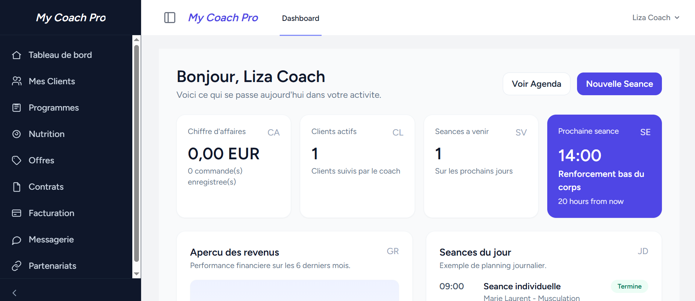

# My-Coach-Pro
Plateforme de gestion de coaching sportif

# My Coach Pro (Archiweb) : plateforme de gestion de coaching sportif

Application web de gestion pour les **salles de sport** et les **coachs sportifs** : suivi des clients, programmes d'entraînement, planning des séances, abonnements, paiement en ligne et messagerie intégrée.

## Aperçu

| Page d'accueil | Espace coach | Espace client |
|---|---|---|
|  |  |  |

## Rôles utilisateurs

- **Gestionnaire de salle** : emploie des coachs et gère le planning de sa salle.
- **Coach** : suit ses clients, crée des programmes, anime des séances individuelles et collectives.
- **Client / membre** : consulte son planning, s'inscrit aux séances et suit sa progression.

## Fonctionnalités

**Espace coach**
- Tableau de bord : chiffre d'affaires, clients actifs, séances à venir, prochaine séance
- Gestion des clients et des programmes
- Plans personnalisés, liens vidéo (YouTube) et conseils personnalisés
- Nutrition, offres, contrats et facturation
- Messagerie et partenariats

**Espace client**
- Tableau de bord avec séance du jour et objectif hebdomadaire
- Catalogue des séances et programmes
- Nutrition, contrats
- Suivi des performances et de la santé

**Gestion de salle**
- Planning de la salle et inscription aux séances
- Séances collectives limitées à 15 personnes, avec file d'attente
- Plans standards d'abonnement
- Intégration d'un système de paiement


## Technologies

- **Back-end** : Laravel (PHP)
- **Front-end** : Vite React, Tailwind
- **Base de données** : MySQL
- **Paiement** : Stripe (mode test)
- **Sessions, cache et files d'attente** : stockés en base de données
- **Outils** : Git / GitHub, Composer, npm

## Installation et lancement
### Prérequis
- PHP [version à vérifier dans `composer.json`] et Composer
- Node.js et npm
- MySQL

### Étapes

```bash
# 1. Cloner le dépôt
git clone [URL DU DÉPÔT]
cd [NOM DU DOSSIER]

# 2. Installer les dépendances
composer install
npm install

# 3. Configurer l'environnement
cp .env.example .env
php artisan key:generate
```

Dans le fichier `.env`, renseigne ensuite :
- la base de données : `DB_PORT`, `DB_DATABASE`, `DB_USERNAME`, `DB_PASSWORD`
- les clés Stripe de test : `STRIPE_KEY` et `STRIPE_SECRET` (disponibles dans le tableau de bord Stripe)

```bash
# 4. Créer les tables
php artisan migrate --seed

# 5. Lancer l'application (dans deux terminaux)
php artisan serve
npm run dev
```

L'application est disponible sur `http://localhost:8000`.

## Mon rôle
Travail sur :
**Espace coach**
- Tableau de bord : chiffre d'affaires, clients actifs, séances à venir, prochaine séance
- Gestion des clients et des programmes
- liens vidéo (YouTube) et conseils personnalisés
- Messagerie

**Espace client**
- Nutrition
- Suivi des performances et de la santé

**Gestion de salle**
- Intégration d'un système de paiement


## Équipe

Travail collectif de 3 personnes

## Contexte

Projet réalisé dans le cadre du Master MIAGE, Université de Haute-Alsace (FST Mulhouse), [année].
